# LUMOOD 루무드

> 20~30대 자취생이 **사기 전에 가상의 방에서 조명의 색·밝기를 직접 바꿔 보고**, 그 분위기 그대로 구매까지 할 수 있게 만든 스마트 무드 조명 쇼핑몰 데모 사이트 (PC·모바일 반응형)

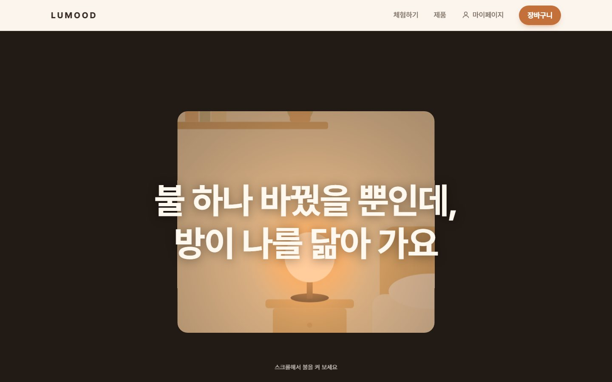

> ⚠ **데모 사이트입니다.** 결제는 실제로 일어나지 않고, 회원·주문 정보는 서버 없이 방문한 브라우저에만 저장됩니다.

## 1. 링크

- **Live Demo**: https://u-el.github.io/my-shop/
- **GitHub**: https://github.com/u-el/my-shop
- **Figma 디자인**: https://www.figma.com/design/T0rXsxZAHFpZeKUMDyOrQJ/%EB%A3%A8%EB%AC%B4%EB%93%9C-LUMOOD-?node-id=0-1 (사이트맵 · 와이어프레임 · 레퍼런스)
- **기획 문서**: [`docs/`](docs) (목적 → 구조 → 사이트맵 → 와이어프레임 → 레퍼런스 → 구현)

## 2. 프로젝트 정보

- **제작 기간**: 2026.11.12 ~ 2026.11.16 (5일)
- **담당 역할**: 개인 프로젝트 (기여도 100%)
- **담당 범위**: 기획 문서 → Figma 사이트맵·와이어프레임·레퍼런스 분석 → 바이브코딩 구현 → GitHub Pages 배포

## 3. 사용 기술

- **React 19, React Router 7**: 체험에서 고른 빛(색·밝기)을 상품 사진·장바구니 등 여러 페이지가 함께 써야 해서, 상태를 Context로 공유하기 쉬운 React를 선택
- **Vite 8**: 빠른 개발 서버, 빌드할 때만 `base`를 `/my-shop/`으로 바꿔 GitHub Pages 하위 경로에 맞춤
- **Motion**: 메인 첫 화면 확장·밝기 다이얼 등 화면 움직임
- **Vitest, Testing Library**: 가격 계산·주문 저장과 화면 동작(가입·세트 주문·찜·메뉴) 테스트
- **GitHub Actions + GitHub Pages**: `main`에 푸시하면 테스트 → 빌드 → 무료 배포 (테스트가 실패하면 배포하지 않음)
- **Figma**: 사이트맵, 페이지별 와이어프레임, 레퍼런스 정리
- **Claude**: 기획 문서 정리, Figma 작업, 바이브코딩 (화면 구현)

## 4. 주요 기능

- **가상 체험** (`/experience`): 가상의 방에서 장면 프리셋·색상·밝기를 바꾸고 무드 조명 / 스마트 전구 / 둘 다 켜 보기. 고른 빛은 사이트 전체의 제품 사진에 그대로 입혀짐
- **스크롤하면 커지는 메인 첫 화면**: 작은 액자 속 방이 화면 가득 커지며 소개가 나타남
- **구매 흐름**: 상품 상세 → 장바구니(무드 조명 + 전구 세트 할인 자동 적용) → 주문서(도로명 주소 검색, 카드·계좌이체·카카오페이·네이버페이 **데모 결제**) → 주문 완료
- **데모 회원**: 가입·로그인, 마이페이지(주문 내역, 기본 배송지, 찜한 상품), 비회원 주문 조회
- **모바일·데스크탑 반응형**: 모바일 햄버거 메뉴, 체험 화면 세로 배치

| 가상 체험 | 장바구니 · 세트 할인 |
| --- | --- |
| 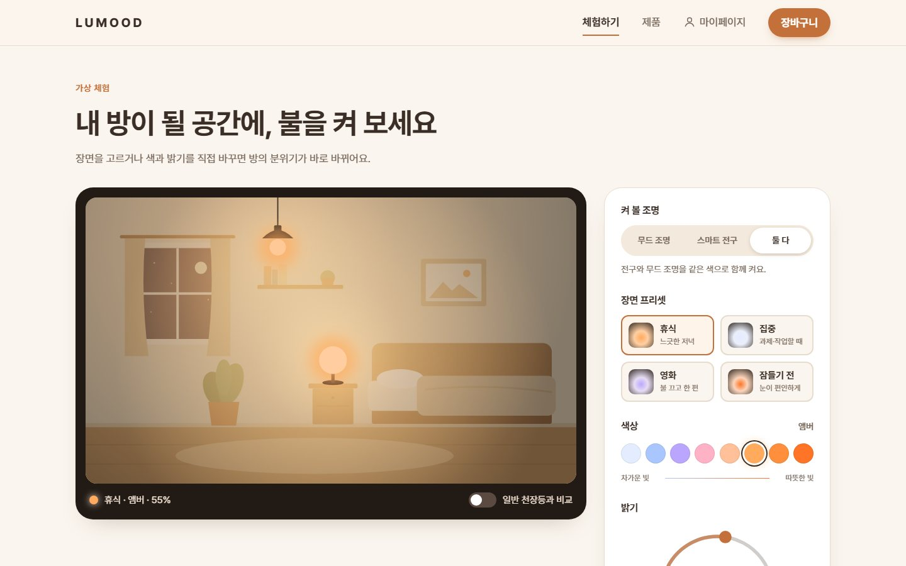 | 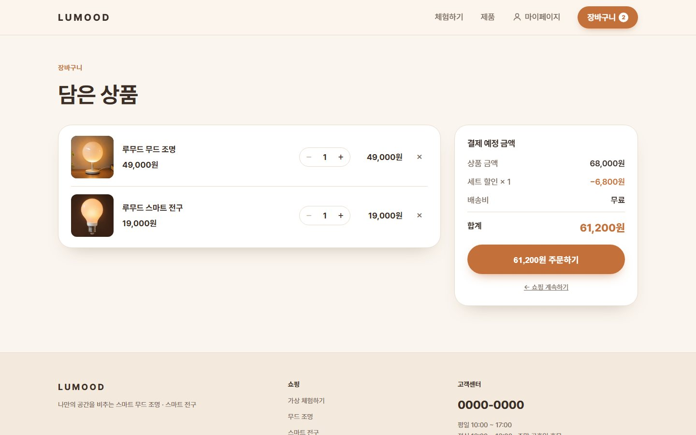 |

## 5. 트러블슈팅

### 이슈 1: 배포 후 하위 페이지로 바로 들어가거나 새로고침하면 404

- **문제**: `https://u-el.github.io/my-shop/experience`처럼 메인이 아닌 주소로 바로 들어가거나 새로고침하면 GitHub Pages의 404 페이지가 나옴
- **원인**: GitHub Pages는 정적 파일만 내려주는데, `/experience` 같은 경로는 React Router가 브라우저 안에서만 만드는 주소라 실제 파일이 없었음
- **해결**: 배포 단계에서 경로마다 `dist/<경로>/index.html`을 복사해 만들고, 그 외 주소용으로 `404.html`도 만듦. 처음엔 `404.html`만 두었다가, 하위 페이지가 404 상태 코드로 응답하는 문제까지 없애려고 경로별 파일 생성으로 바꿈 (새 페이지를 추가하면 [`deploy.yml`](.github/workflows/deploy.yml)의 경로 목록에도 넣어야 함)

### 이슈 2: 페이지를 이동하면 앱 전체가 흰 화면이 됨

- **문제**: 페이지를 이동할 때 `destroy is not a function` 오류와 함께 화면 전체가 비어 버림
- **원인**: 페이지 이동 시 맨 위로 올리는 `ScrollToTop`의 `useEffect`를 `() => window.scrollTo(0, 0)`처럼 썼는데, 최신 브라우저에서는 `scrollTo`가 Promise를 돌려줌. React가 그 반환값을 정리(cleanup) 함수로 실행하려다 오류가 남
- **해결**: 중괄호로 감싸 `() => { window.scrollTo(0, 0); }` 처럼 아무것도 반환하지 않게 수정

## 6. AI 활용 방식

- **맡긴 일**
  - 기획 문서 분석 → Figma 사이트맵·와이어프레임 그리기 + 같은 내용을 MD 문서로 저장
  - 레퍼런스 사이트 검토와 적용 방향 정리
  - 와이어프레임을 React 화면으로 구현, 테스트 작성, GitHub Pages 배포 설정
- **핵심 프롬프트**
  - "페이지별 와이어프레임을 만들어줘. Figma에 페이지마다 프레임 하나씩 그리고, 내용은 docs/04-site-wireframe.md로도 저장해줘. … Figma와 MD의 내용이 서로 다르면 안 돼."
  - "각 레퍼런스마다 직접 확인할 수 있는 특징, 그 특징이 만드는 인상, 적용할 페이지나 섹션과 이유, 목적과 맞지 않아 적용하지 않을 부분을 구분해서 정리해줘. 확인하지 못한 폰트명·색상값·간격은 추측해서 확정하지 마."

## 7. 회고

- **배운 점**: 목적 → 구조 → 사이트맵 → 와이어프레임 → 레퍼런스 순서로 문서를 먼저 쌓아 두니, AI에게 구현을 맡길 때도 "문서 기준"으로 판단하게 할 수 있었다.
- **아쉬운 점**: 구현하면서 외부 스토어 링크 → 사이트 안 직접 구매로 바뀌었는데, 03·04 문서와 Figma에는 아직 반영하지 못했다. 결제·회원도 서버 없는 데모 수준이다.

---

## 부록

### 실행

```bash
npm install
npm run dev      # 개발 서버 (http://localhost:5173)
npm test         # 가격 계산·주문 저장 + 화면 동작 테스트
npm run build    # 배포용 빌드 (dist/)
```

### 화면 더 보기

| 메인 · 스크롤하면 방이 커지며 소개 등장 | 제품 라인업 |
| --- | --- |
| 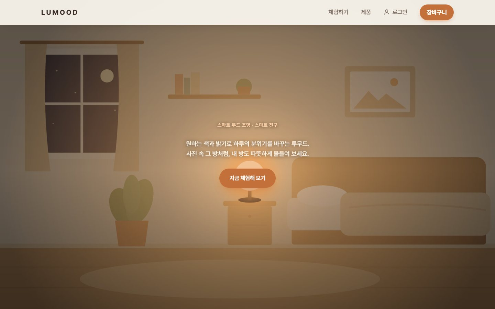 | 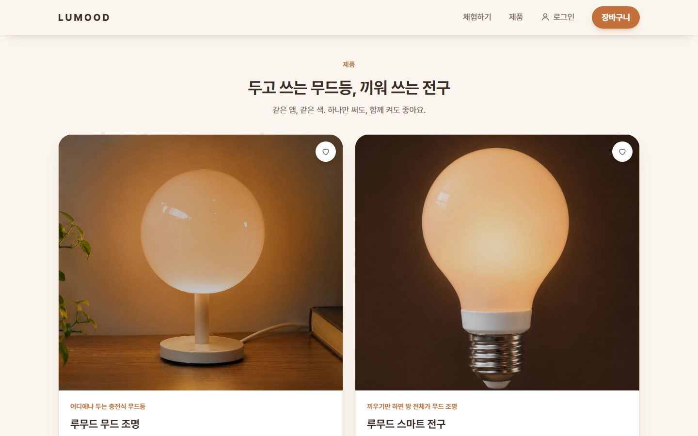 |
| **상품 상세** | **주문서 · 카카오페이 데모 승인** |
| 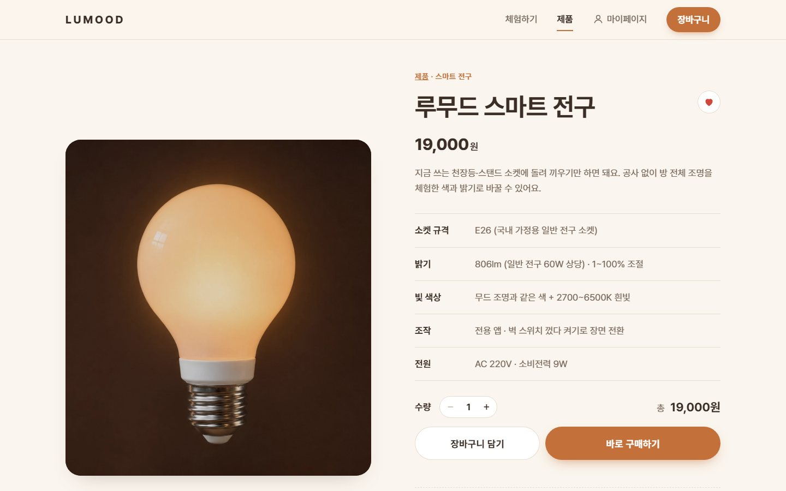 | 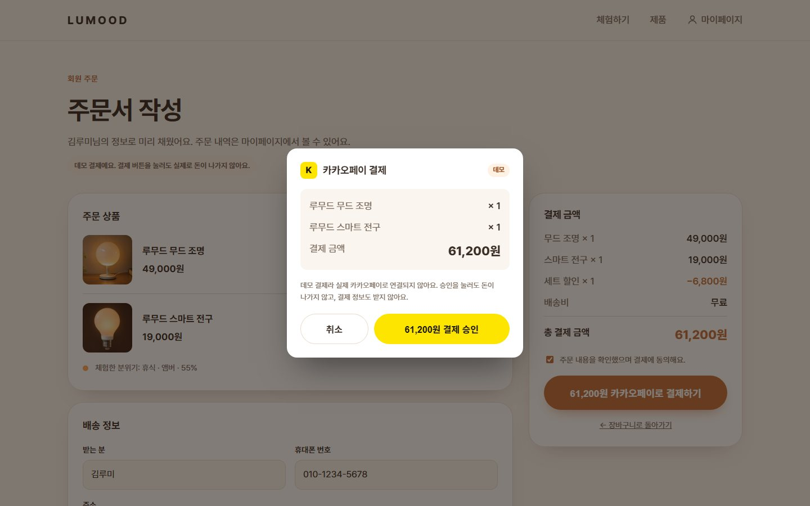 |
| **마이페이지** | |
| 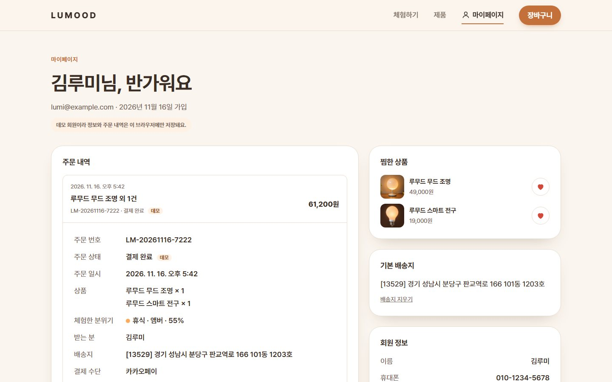 | |

| 모바일 메인 | 모바일 체험 | 모바일 메뉴 | 모바일 세트 할인 |
| --- | --- | --- | --- |
|  | 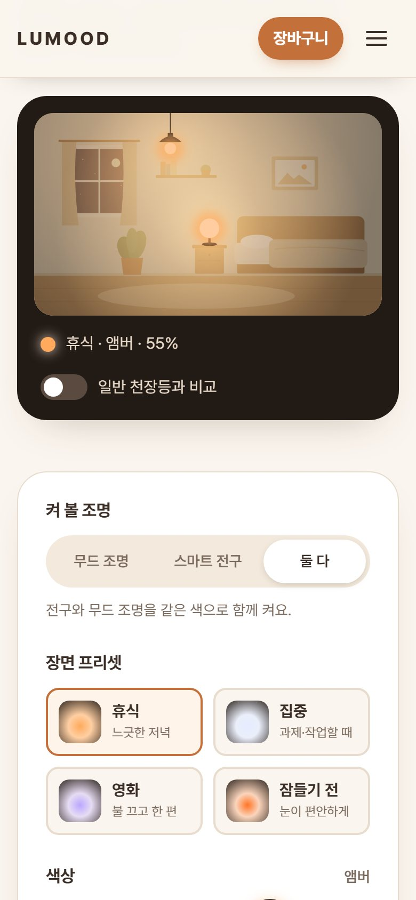 | 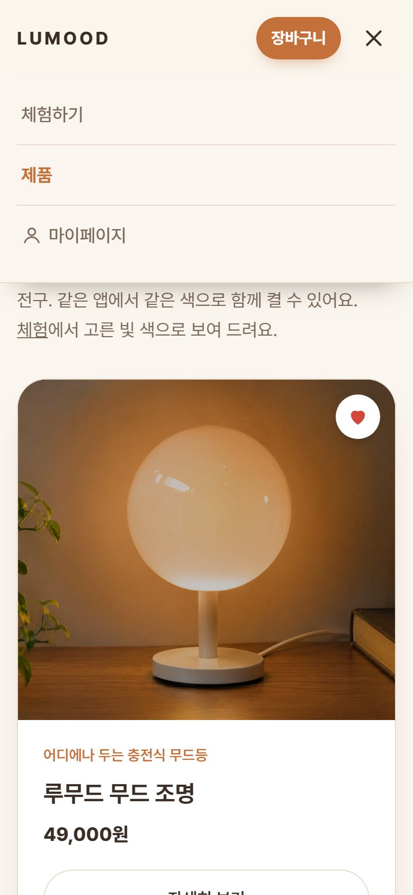 | 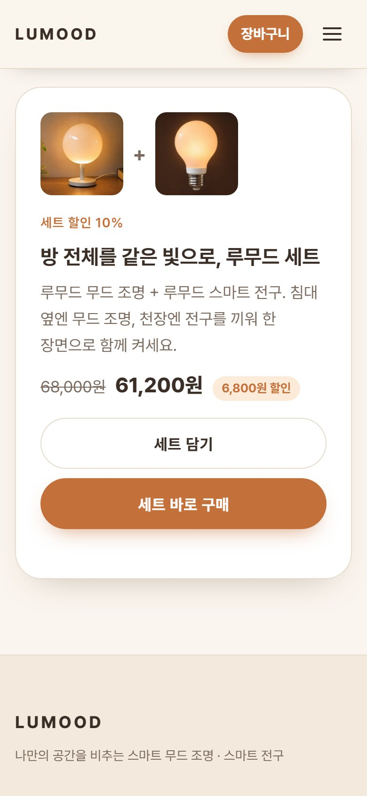 |

### 전체 기능

| 영역 | 내용 |
| --- | --- |
| 메인 | 스크롤하면 커지는 첫 화면, 특징, 체험 안내, 제품 라인업, 세트 할인, 후기(예시) |
| 가상 체험 (`/experience`) | 장면·색·밝기를 고르고 무드 조명 / 전구 / 둘 다 켜 보기 |
| 제품 (`/product`, `/product/:id`) | 체험한 색으로 물든 제품 사진, 사양, FAQ, 상품정보제공고시, 찜하기 |
| 세트 할인 | 무드 조명 + 전구를 함께 사면 세트 수만큼 10% 할인 (자동 적용) |
| 장바구니 (`/cart`) | 수량 변경·삭제, 함께 사면 좋은 상품 담기 |
| 주문 (`/checkout`) | 도로명 주소 검색(카카오 우편번호), 카드·계좌이체·카카오페이·네이버페이 **데모 결제** |
| 비회원 주문 조회 (`/order-lookup`) | 주문 번호 + 휴대폰 번호 |
| 데모 회원 (`/signup`, `/login`, `/mypage`) | 가입·로그인, 주문 내역, 기본 배송지, 찜한 상품, 탈퇴 |
| 약관 (`/terms`, `/privacy`, `/refund`) | 이용약관, 개인정보처리방침, 교환·반품 안내 (초안) |

### 내용 바꾸는 곳

| 바꿀 것 | 파일 |
| --- | --- |
| 상품 이름·가격·사양·FAQ·상품정보제공고시 | `src/data/products.js` |
| 세트 할인율 | `src/data/pricing.js` (`BUNDLE`) |
| 색상·장면, 메인 특징, 후기, 배송비·최대 수량·결제 수단, 회사 정보 | `src/data/content.js` |
| 약관·개인정보처리방침·교환반품 | `src/data/legal.js` |
| 상품 사진 | `src/assets/product-*.jpg` (사진 속 유리구 위치는 `src/components/ProductVisual.jsx`) |
| 링크 미리보기 문구·이미지 | `index.html`, `public/og-image.png` |

### 실제 판매 전에 꼭 할 일

데모용으로 채운 **임시 값**입니다. 코드에서 `임시안`, `확정 후 기재` 를 검색하면 찾을 수 있습니다.

- [ ] 사업자 정보·통신판매업 신고번호·고객센터 연락처 (`content.js`의 `COMPANY`)
- [ ] KC 인증번호, 제조자·제조국 (`products.js`의 `notice`)
- [ ] 실제 가격·할인율·사양
- [ ] 실제 구매 후기로 바꾸고 `REVIEWS_ARE_SAMPLES = false`
- [ ] 약관·개인정보처리방침 법률 검토
- [ ] 결제대행사(PG) 계약 후 실제 결제 연동
- [ ] 회원·주문을 서버(예: Supabase)로 옮기기. 지금은 **비밀번호를 저장·확인하지 않는** 데모 로그인입니다

### 구조

```
src/
  pages/        페이지 (메인 외에는 들어갈 때 불러옴)
  components/   헤더·푸터·상품 카드·세트 카드·결제 창 등
  context/      빛(색·밝기) · 장바구니 · 데모 회원 상태
  data/         상품·문구·가격 계산·주문 저장 (+ *.test.js)
docs/           기획 문서
```
