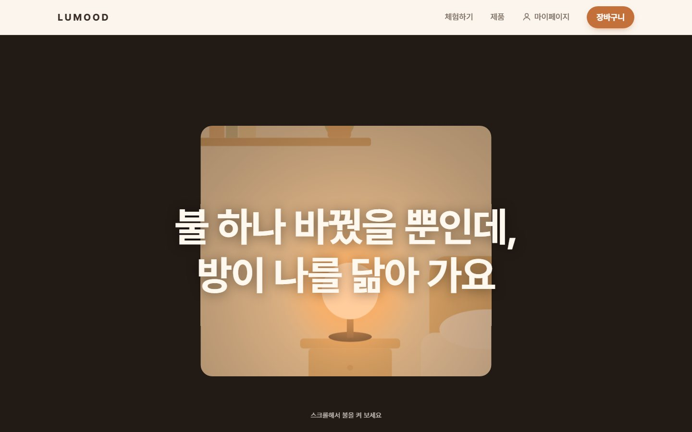
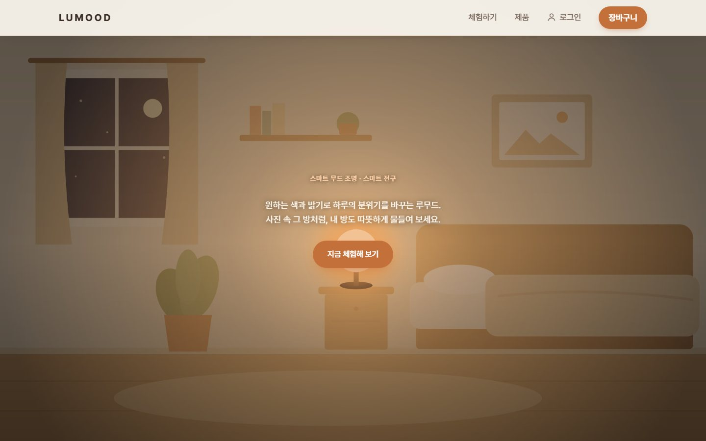
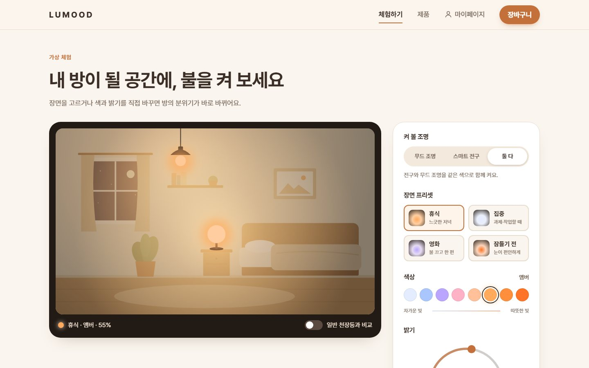
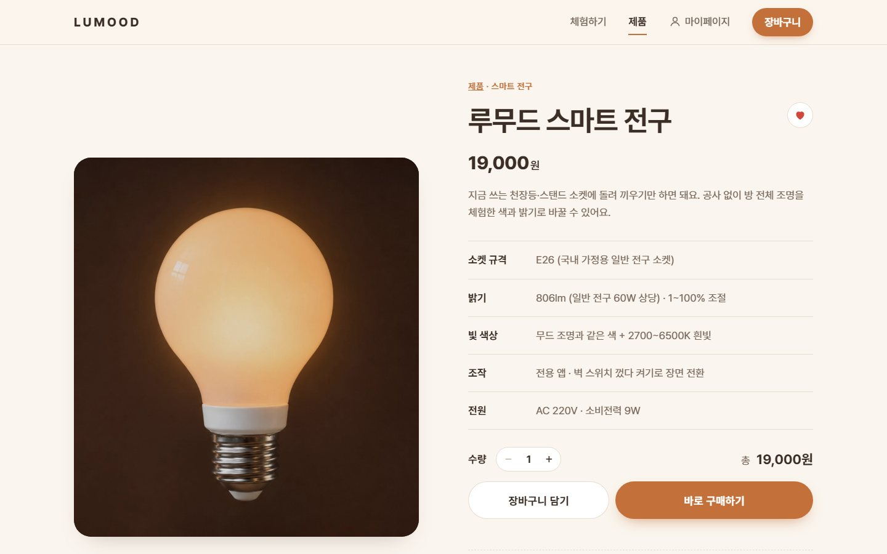
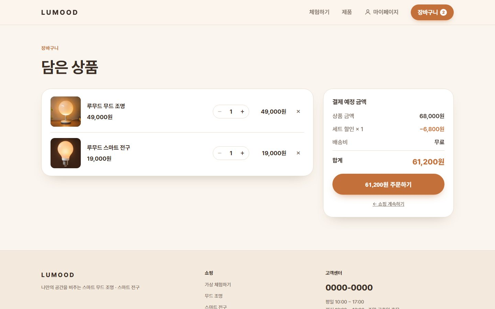
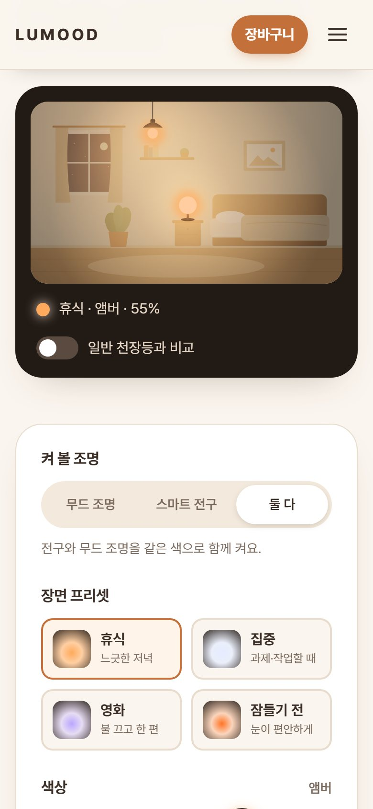
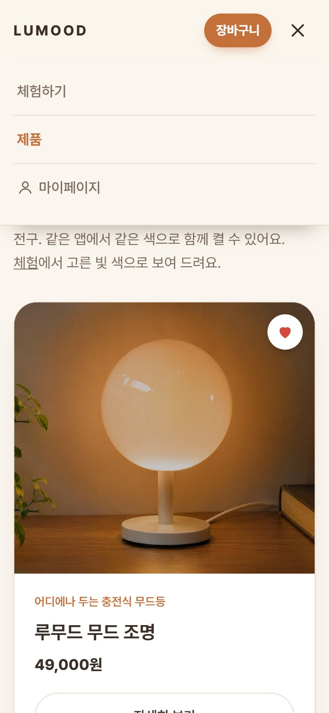

# LUMOOD 루무드 — 케이스 스터디 초안

> 작성 기준: `PROJECT_CONTEXT.md`, `prd.md`, `test-cases.md`, `TEXTCASE.md`, `README.md`, `docs/01-site-purpose.md`, `docs/05-site-reference.md`, `docs/06-implementation.md`, `docs/screenshots/`
> 표기: **✏️ 직접 채우기** = 문서에서 확인되지 않아 비워 둔 곳 / **(초안)** = 문서에는 없지만 흐름상 제안하는 문장
> 참고: `design.md`는 저장소에 없어서, 디자인 기준은 `PROJECT_CONTEXT.md` 4번을 썼습니다.

## 전체 흐름

| 순서 | 페이지 | 이 프로젝트에서 보여줄 것 |
| --- | --- | --- |
| 01 | 인트로 | 사기 전에 가상의 방에서 조명을 켜 보는 쇼핑몰 데모, 배포 링크 |
| 02 | 기획 의도 | 사진만으로는 내 방 분위기를 알 수 없다는 한계 → 구매 전에 직접 켜 보는 경험 |
| 03 | 핵심 가설 | 색·밝기를 바꾸면 방이 바로 바뀌는 인터랙션 → 상품 상세까지 이동한다 |
| 04 | 레퍼런스 & 비주얼 디렉션 | 레퍼런스에서 가져온 것과 뺀 것, 따뜻한 톤과 어두운 무대 |
| 05 | 인터랙션 설계 | 가상 체험(조절 → 즉시 반영), 체험한 빛 유지, 천장등 비교, 첫 화면 확장 |
| 06 | 완성된 화면 | 메인·체험·상품 상세·장바구니, PC와 모바일 |
| 07 | 요구사항 & 테스트 | R-08~R-14(상)와 TC-10·TC-11·TC-14·TC-16 연결, 26건 결과 |
| 08 | 바이브코딩 구현 | 문서를 기준으로 AI와 일한 방식, 내가 바꾼 설계 판단 |
| 09 | 회고 | 문서와 구현의 차이, 임시안, 데모 범위 |
| 10 | 가설 검증 | 동작은 확인했고, 사용자 행동 검증은 아직 범위 밖이라는 결론 |

---

## 01. 인트로

**LUMOOD 루무드**
사기 전에 가상의 방에서 조명의 색·밝기를 직접 바꿔 보고, 그 분위기 그대로 구매까지 할 수 있는 스마트 무드 조명·스마트 전구 쇼핑몰 데모 사이트 (출처: PROJECT_CONTEXT.md 1)

> ⚠ 데모 사이트입니다. 결제는 실제로 일어나지 않고, 회원·주문 정보는 서버 없이 방문한 브라우저에만 저장됩니다. 가격·사양·후기는 임시안·예시입니다. (출처: README.md, prd.md 3-2)
> ✏️ 직접 채우기: 루무드가 가상 브랜드인지 한 줄로 밝혀 주세요. 문서에는 "데모 사이트", "브랜드 사이트"로만 적혀 있고 "가상 브랜드"라는 표현은 없습니다.

| 항목 | 내용 |
| --- | --- |
| 배포 링크 | https://u-el.github.io/my-shop/ (출처: README.md, prd.md) |
| GitHub | https://github.com/u-el/my-shop (출처: README.md) |
| Figma | [사이트맵 · 와이어프레임 · 레퍼런스](https://www.figma.com/design/T0rXsxZAHFpZeKUMDyOrQJ/%EB%A3%A8%EB%AC%B4%EB%93%9C-LUMOOD-?node-id=0-1) (출처: README.md) |
| 기간 | 2026.11.12 ~ 2026.11.17 (6일) |
| 나의 역할 | 개인 프로젝트, 기여도 100% (출처: README.md 2)<br>· 기획: 목적·구조·사이트맵·와이어프레임 문서, PRD(요구사항 정의서)<br>· 디자인: 디자인 시스템(CSS 변수로 컬러·글꼴·컴포넌트 기준 정리)<br>· 바이브코딩: Claude와 React로 화면 구현, 테스트, GitHub Pages 배포<br>✏️ 직접 채우기: 역할별로 내가 직접 한 부분과 AI에게 맡긴 부분의 비중 |
| Tech & Tools | React 19, React Router 7, Vite 8, Motion, Vitest + Testing Library, GitHub Actions + GitHub Pages, Figma, Claude (출처: README.md 3) |
| 포커스 | (초안) 구매 전에 가상의 방에서 조명을 직접 켜 보고, 고른 빛이 상품 화면까지 이어지는 체험 흐름 |

---

## 02. 기획 의도

**배경**
- 방문자는 내 방에 두면 실제로 어떤 분위기가 될지 알고 싶어 하지만, 사진에서 본 분위기와 실제가 다를까 봐 구매를 망설인다. (출처: docs/01-site-purpose.md 2)
- (초안) 조명 쇼핑몰은 대부분 완성된 연출 사진으로 분위기를 보여준다. 색과 밝기를 바꿔 볼 수 없어서, 내 방에서는 어떨지 상상에 맡겨야 한다.
- ✏️ 직접 채우기: 직접 들어가 본 기존 조명 쇼핑몰 한 곳과, 거기서 느낀 구체적인 아쉬움 한 가지

**목표**
- 조명의 색상과 밝기에 따른 공간 변화를 구매 전에 가상으로 체험하고, 내 방에서도 원하는 분위기가 날지 예상해 보며 구매를 결정하도록 돕는다. (출처: docs/01-site-purpose.md 1)
- 전달하고 싶은 감각: 따뜻하고 아늑하며 편안한, 나만의 공간이라는 느낌 (출처: docs/01-site-purpose.md 4)

**타깃 사용자**
SNS에서 감성적인 방 사진을 보고 들어온, 방 분위기를 바꾸고 싶은 20~30대 자취생 (출처: docs/01-site-purpose.md 2)

**배경과 목표의 연결**
(초안) 사진은 보기만 할 수 있어서 "내 방에서도 저럴까"라는 불안이 남는다. 그래서 보는 대신 직접 켜 보게 했다. 방문자 흐름도 이 순서로 설계했다: SNS 방 사진 → "내 방에서도 저런 분위기가 날까?" → 가상 공간에서 색상·밝기 조절 → 불안 해소 → 상품 확인 → 구매 (출처: docs/01-site-purpose.md 3)

---

## 03. 핵심 가설

> 기획 문서에는 가설이 따로 적혀 있지 않습니다. 아래는 문서의 목적·핵심 행동을 바탕으로 정리한 (초안)입니다.

**가설 설정 배경**
(초안) 방문자가 망설이는 이유는 "사진과 실제가 다를까 봐"였다(출처: docs/01-site-purpose.md 2). 직접 바꿔 보고 결과를 바로 보면 그 불안이 줄어들 것이라고 봤다.

**IF-THEN**
- **IF** (초안) 체험 화면에서 색상·밝기를 바꾸는 순간 옆의 가상 방의 빛이 바로 바뀌면
- **THEN** (초안) 20~30대 자취생 방문자는 색이나 밝기를 2번 이상 바꿔 본 뒤, "이 분위기로 … 보기" 버튼을 눌러 상품 상세까지 이동한다.

**검증 방향**
(초안) TC-10·TC-11로 조절 즉시 방이 바뀌는지, TC-16·TC-25로 체험에서 상품 상세·주문까지 같은 빛으로 이어지는지 확인한다. 실제 방문자가 상품 상세까지 가는지는 다른 사람에게 테스트를 맡겨 관찰한다(07-3, 10 참고).

---

## 04. 레퍼런스 & 비주얼 디렉션

**디자인 시스템**
(초안) Figma 스타일 보드 없이, 컬러·글꼴·모서리·버튼 기준을 CSS 변수로 정리했다.
- 컬러: 배경 3단계(페이지·카드·따뜻한 면) + 어두운 무대 1개, 글자 2단계, 포인트 1개, 선 1개
- 글꼴: Pretendard, 본문 17px · 줄 간격 1.65, 제목 700
- 컴포넌트: 알약형 버튼(주 버튼 / 보조 버튼), 모서리 28px(큰 박스) · 18px(카드) · 12px(작은 요소), 따뜻한 갈색 톤 그림자

(출처: PROJECT_CONTEXT.md 4, src/styles.css. Figma 무드 시안·스타일 보드는 [미정])

**레퍼런스 — 가져온 것** (출처: docs/05-site-reference.md, PROJECT_CONTEXT.md 4)

| 레퍼런스 | 가져온 것 | 적용 위치 |
| --- | --- | --- |
| Häfele LOOX Light Room · Nanoleaf 편집 화면 | 공간(결과)을 가장 크게, 조작 도구는 바로 곁에 | 체험 페이지: 가상 공간과 조절 패널을 한 화면에 좌우 배치 |
| Philips Hue Features 장면 타일 | 프리셋 = 색과 밝기의 조합, 색 미리보기 + 이름 타일로 고르기 | 체험 페이지: 장면 프리셋 타일 |
| Ohouse AI 전/후 비교 | 같은 공간의 전/후를 비교해 변화를 납득시키기 | 체험 페이지: 일반 천장등과 좌우 드래그 비교 |
| (보조) Philips Hue rooms · Hue KR | 따뜻한 방 이미지를 가로 전체로 + 짧은 제목 / 차가운 빛 → 따뜻한 빛 흐름 | 메인 첫 화면 / 색상 배열 |

**레퍼런스 — 뺀 것** (출처: docs/05-site-reference.md 각 x-4)
- 어두운 남색 메뉴, 강한 RGB 보라·분홍 장면: 차갑고 기계적인 인상이라 뺐다.
- 방 유형 고르기, 가구 바꾸기, 많은 도구: 조절 대상을 조명 색·밝기로 좁혔다.

**비주얼 디렉션**
(초안) 따뜻하고 밝은 바탕 위에, 빛을 보여주는 곳만 어둡게 둔다.
(근거: 페이지 바탕과 메뉴는 밝고 따뜻하게, 어두운 처리는 가상 공간 주변에만, 출처: docs/05-site-reference.md 7-2)

**컬러** (출처: PROJECT_CONTEXT.md 4)
| 역할 | 값 | 이유 |
| --- | --- | --- |
| 배경 | `#faf5ee` | 따뜻하고 아늑한 인상, 조명 색을 방해하지 않는 바탕 (출처: docs/05-site-reference.md 6-4·7-2) |
| 무대 | `#221a15` | 가상 공간·첫 화면 주변만 어둡게 해 빛의 차이를 분명하게 (출처: docs/05-site-reference.md 1-3·7-2) |
| 글자 | `#3a2e26` / `#7a6a5d` | ✏️ 직접 채우기: 갈색 계열 글자색을 고른 이유 |
| 포인트 | `#c4703a` | 주 버튼·장바구니·할인 금액에 사용. ✏️ 직접 채우기: 이 색을 고른 이유 |

**타이포그래피**
Pretendard. 본문 17px · 줄 간격 1.65, 제목 700 (출처: PROJECT_CONTEXT.md 4)
✏️ 직접 채우기: Pretendard를 고른 이유

**인터랙션 무드**
(초안) 느리고 부드럽게. 문서에 적힌 움직임이 "살짝 떠오름", "천천히 오르내림", "숨 쉬듯 은은하게", "관성 있게"이고(출처: PROJECT_CONTEXT.md 5), 동작 줄이기 설정 시에는 모두 끈다.

---

## 05. 인터랙션 설계

**사이트 구성 한눈에 보기** (출처: PROJECT_CONTEXT.md 3)

```
메인 /  ──[지금 체험해 보기]──▶  ★ 가상 체험 /experience
 │  ① 첫 화면 확장(★)                │  가상 공간 + 조절 패널(★)
 │  ② 특징 ③ 체험 안내               │  천장등 비교(★)
 │  ④ 제품 라인업 ⑤ 후기(예시)       │
 │                                   ├─[이 분위기로 무드 조명 보기]─▶ 상품 상세 /product/lamp ─┐
 └─[제품 카드]─▶ 제품 목록 /product ◀─[둘 다: 이 분위기로 제품 보기]  /product/bulb          │
                  (체험한 색으로 물든 사진 ★)                   (체험한 색·밝기 유지 ★)      │
                                     └─[세트 구매하기]────────────────────────────┐          │
                                                                                  ▼          ▼
                                     장바구니 /cart ──▶ 주문서 /checkout ──▶ 주문 완료 /order-complete
보조: 로그인·회원가입 · 마이페이지 · 비회원 주문 조회 · 약관 · 404        ★ = 핵심 인터랙션 위치
```

> 참고: Figma 사이트맵·와이어프레임은 처음 기획(3페이지, 외부 스토어) 그대로라 현재 구현과 다릅니다. 위 구성은 구현 기준입니다. (출처: PROJECT_CONTEXT.md 4)

### 인터랙션 1. 조절하면 바로 바뀌는 가상 방 (핵심)
- **무엇을**: 켜 볼 조명(무드 조명 / 스마트 전구 / 둘 다), 장면 프리셋 4개, 색상 8개, 밝기 다이얼(5~100%)을 바꾸면 가상 방의 빛이 즉시 바뀐다. 상태 표시줄에 "프리셋 · 색 이름 · 밝기%"가 함께 바뀐다. (출처: PROJECT_CONTEXT.md 5, prd.md R-08~R-10)
- **왜**: 03 가설의 IF. 조작과 결과를 한 시야에 두어야 "실시간 반영"을 체감할 수 있다. 처음 와이어프레임은 공간과 조절 도구가 위아래 섹션으로 나뉘어 있었는데, 레퍼런스 검토 후 한 화면에 붙였다. (출처: docs/05-site-reference.md 7-3 ①, README.md 7)
- **어떻게**: 빛 상태를 React Context로 공유, 가상 공간은 SVG 자취방 일러스트(임시안), 밝기 다이얼은 Motion의 spring으로 관성 있게 움직이고 포인터 이벤트라 터치 드래그도 된다. (출처: PROJECT_CONTEXT.md 5·6·7·8, src/components/CometDial/CometDial.jsx)

### 인터랙션 2. 체험한 빛이 상품 화면까지 이어짐
- **무엇을**: 체험에서 고른 색·밝기가 제품 카드 사진, 상품 상세 사진, 구매 섹션의 "프리셋 · 색 이름 · 밝기%"에 그대로 적용된다. (출처: PROJECT_CONTEXT.md 5, prd.md R-06·R-14)
- **왜**: (초안) 체험이 체험으로 끝나지 않고, "이 분위기 그대로" 상품을 보고 살 수 있게 하기 위해. 03 THEN(상품 상세까지 이동)이 일어나는 길이다.
- **어떻게**: 빛 상태(LightContext)를 여러 페이지가 함께 쓰고, 상품 사진 위에 고른 색을 입힌다. React를 고른 이유도 이 상태 공유였다. (출처: README.md 3, PROJECT_CONTEXT.md 6)

### 인터랙션 3. 일반 천장등과 좌우 비교
- **무엇을**: "일반 천장등과 비교" 스위치를 켜면 구분선이 생기고, 드래그해 일반 천장등 방과 루무드 방을 비교한다. (출처: prd.md R-11)
- **왜**: 방문자의 불안은 "사진과 실제가 다를까 봐"다. 내 조절로 공간이 얼마나 달라졌는지 비교하면 변화를 확신할 수 있다. (출처: docs/05-site-reference.md 6-3)
- **어떻게**: 포인터 이벤트 드래그. 터치로도 조작된다. (출처: PROJECT_CONTEXT.md 7)

### (보조) 스크롤하면 커지는 메인 첫 화면
- 작은 액자 속 방이 스크롤하면 화면 가득 커지며 제목·소개·"지금 체험해 보기" 버튼이 나타난다. SNS 방 사진으로 들어온 방문자에게 같은 결의 첫인상을 주고 체험으로 이끈다. (출처: PROJECT_CONTEXT.md 5, docs/05-site-reference.md 3-3)

---

## 06. 완성된 화면

**▶ 직접 체험해 보기: https://u-el.github.io/my-shop/**

| 화면 | 한 줄 설명 |
| --- | --- |
|   | 메인: 작은 액자 속 방이 스크롤하면 화면 가득 커지며 소개가 나타난다 |
|  | 가상 체험: 무드 조명과 천장 전구를 같은 앰버 빛으로 켠 방, 오른쪽 조절 패널 |
|  | 상품 상세: 체험한 빛으로 물든 사진과 사양·수량·찜 |
|  | 장바구니: 무드 조명 + 전구를 함께 담으면 세트 할인 자동 적용 |
|   | 모바일: 체험 화면 세로 배치, 햄버거 메뉴 |

(캡처 설명 출처: README.md)

- ✏️ 직접 채우기: 핵심 인터랙션 GIF 또는 영상 — ① 체험 화면에서 프리셋·색·밝기를 바꾸는 장면 ② 천장등 비교 드래그 ③ 메인 첫 화면 확장 ④ 모바일에서 다이얼 드래그
- ✏️ 직접 채우기: "체험 → 이 분위기로 무드 조명 보기 → 같은 빛의 상품 사진"으로 이어지는 연속 캡처

---

## 07. 요구사항 & 테스트

### 7-1. 요구사항 정의 (출처: prd.md 2)

> 문서의 번호 체계는 FR-이 아니라 R-입니다. 문서 그대로 씁니다. 전체 20개 중 가설과 직결된 것을 골랐습니다.

| ID | 요구사항 | 우선순위 |
| --- | --- | --- |
| R-09 | 장면 프리셋 타일을 골라 색과 밝기를 한 번에 바꿀 수 있다. 누르면 가상 공간의 빛과 상태 표시줄이 바로 바뀐다. | 상 |
| R-10 | 색상 8개(차가운 빛 → 따뜻한 빛)와 밝기 다이얼(5~100%)로 직접 조절하면 가상 공간에 바로 반영된다. | 상 |
| R-13 | 터치 화면에서 밝기 다이얼과 비교 구분선을 손가락으로 조작할 수 있다. | 상 |
| R-14 | 체험한 분위기를 유지한 채 제품 화면으로 넘어간다. 상품 사진과 구매 섹션에 같은 "프리셋 · 색 이름 · 밝기%"가 표시된다. | 상 |
| R-11 | 일반 천장등만 켠 방과 루무드를 켠 방을 좌우로 비교할 수 있다. | 중 |

(초안) 03의 IF는 R-09·R-10으로, THEN으로 가는 길은 R-14로 내려왔다. 그래서 이 셋을 '상'으로 두었다.

### 7-2. 테스트 케이스 (출처: test-cases.md 1)

| TC | 연결된 요구사항 | 절차 | 기대 결과 |
| --- | --- | --- | --- |
| TC-11 | R-10 | `/experience`에서 색상 동그라미를 왼쪽부터 하나씩 누르고, 밝기 다이얼을 양쪽 끝까지 돌린다 | 누를 때마다 방의 빛 색이 바뀐다. 밝기는 5~100% 안에서만 바뀌고 숫자에 맞춰 방이 밝아지거나 어두워진다 |
| TC-16 | R-14 | 프리셋 "영화"를 누르고 상태 표시줄 글자를 적어 둔 뒤, "무드 조명" → "이 분위기로 무드 조명 보기"를 누른다 | 상품 사진 속 빛이 체험에서 고른 색이다. 구매 섹션의 "프리셋 · 색 이름 · 밝기%"가 적어 둔 글자와 같다 |
| TC-14 (모바일) | R-13 | 390px 탭 모드로 `/experience`를 열고, 밝기 다이얼을 누른 채 원을 따라 끌고, 비교 스위치를 켠 뒤 구분선을 좌우로 끈다 | 다이얼 숫자와 방의 밝기가 바뀐다. 구분선이 끈 위치로 옮겨 간다 |
| TC-25 (흐름) | R-05, R-08, R-09, R-10, R-14, R-17 | 메인 → 체험 → 휴식·캔들·30% 근처로 조절 → 이 분위기로 무드 조명 보기 → 바로 구매 → 카카오페이 데모 결제 | 상품 상세의 조합 글자가 체험에서 적은 것과 같고, 주문 완료에 무드 조명 주문이 보인다 |

> 참고: 테스트 케이스 문서가 두 개 있습니다. `test-cases.md`(TC-01~26, 결과 기록 있음)를 기준으로 썼고, `TEXTCASE.md`(TC-01~48)는 결과 칸이 비어 있고 번호가 다릅니다. 하나로 정리해 두면 좋습니다.

### 7-3. 테스트 결과 & 개선

**누가 테스트했는가**
✏️ 직접 채우기: 테스트한 사람(본인 / 짝꿍·동료 / 몇 명), 사용한 브라우저·기기
문서에는 "2026-11-17 확인 결과 모두 통과"라고만 적혀 있습니다. (출처: test-cases.md)
(초안) 만든 사람은 사이트의 순서를 알고 있어서 막히는 곳을 놓치기 쉽다. 다음에는 처음 보는 사람에게 맡긴다.

**결과 표** (출처: test-cases.md 1·2, 확인일 2026-11-17)

| TC | 요구사항 | 결과 | 발견한 문제 |
| --- | --- | --- | --- |
| TC-11 | R-10 | 통과 | 기록 없음 |
| TC-16 | R-14 | 통과 | 기록 없음 |
| TC-14 | R-13 | 통과 | 기록 없음 |
| TC-25 | R-05·08·09·10·14·17 | 통과 | 기록 없음 |
| 전체 | R-01~R-20 | 26건 중 26건 통과 (상 9 · 중 12 · 하 5), 실패 0건 | — |

**수정 전 / 후**
- 테스트 문서에는 실패나 수정 기록이 없습니다.
- ✏️ 직접 채우기: 테스트 중에 고친 것이 있었다면 그 1~2건과 수정 전/후 캡처
- 참고로, 테스트 케이스 밖에서 개발·배포 중에 고친 문제는 문서에 두 건 있습니다. (출처: README.md 5)

| 문제 | 원인 | 수정 |
| --- | --- | --- |
| 배포 후 하위 주소로 바로 들어가거나 새로고침하면 404 | GitHub Pages는 정적 파일만 주는데, `/experience` 같은 경로는 브라우저 안에서만 만들어지는 주소 | 배포할 때 경로마다 `index.html`을 복사하고 `404.html`도 생성 |
| 페이지를 이동하면 화면 전체가 흰 화면 (`destroy is not a function`) | `useEffect`가 `scrollTo`의 반환값(Promise)을 정리 함수로 넘김 | 중괄호로 감싸 아무것도 반환하지 않게 수정 |

✏️ 직접 채우기: 위 두 건의 수정 전/후 캡처를 넣을지 결정

**재확인**
✏️ 직접 채우기: 수정 후 같은 케이스를 다시 돌려 통과했는지
(문서 근거: main에 push하면 GitHub Actions에서 테스트 → 빌드 → 배포하고, 테스트가 실패하면 배포하지 않는다. 출처: PROJECT_CONTEXT.md 8)

---

## 08. 바이브코딩 구현

**협업 방식**
(초안) 기획 문서를 먼저 쌓고, 매번 "이 문서를 기준으로" 작업을 요청한 뒤 결과를 문서와 대조해 고치는 방식. 코드 리뷰처럼 기준 문서를 사이에 두고 AI와 주고받았다. (근거: README.md 7 배운 점)

**구현 환경**
React 19, React Router 7, Vite 8, Motion, Vitest + Testing Library, GitHub Actions + GitHub Pages, Figma, Claude (출처: README.md 3)

**내가 설계한 것**
- 문서 순서: 목적(01) → 구조(02) → 사이트맵(03) → 와이어프레임(04) → 레퍼런스(05) → 구현(06) (출처: README.md 7)
- 확정 사항과 추후 결정 사항을 나눠 적고, 임시로 채운 값(`임시안`)을 `src/data/content.js` 한곳에서 관리 (출처: README.md 7)
- 상태 구조: 빛(프리셋·색·밝기) · 장바구니 · 데모 회원을 Context로 공유 (출처: PROJECT_CONTEXT.md 8)
- 프롬프트 설계: 결과물 형식과 금지 사항을 함께 지정 (출처: README.md 6)
  - "페이지별 와이어프레임을 만들어줘. Figma에 페이지마다 프레임 하나씩 그리고, 내용은 docs/04-site-wireframe.md로도 저장해줘. … Figma와 MD의 내용이 서로 다르면 안 돼."
  - "각 레퍼런스마다 직접 확인할 수 있는 특징, 그 특징이 만드는 인상, 적용할 페이지나 섹션과 이유, 목적과 맞지 않아 적용하지 않을 부분을 구분해서 정리해줘. 확인하지 못한 폰트명·색상값·간격은 추측해서 확정하지 마."

**AI에게 맡긴 것** (출처: README.md 6)
- 기획 문서 분석 → Figma 사이트맵·와이어프레임 그리기 + 같은 내용을 MD 문서로 저장
- 레퍼런스 사이트 검토와 적용 방향 정리
- 와이어프레임을 React 화면으로 구현, 테스트 작성, GitHub Pages 배포 설정

**내가 직접 판단하고 수정한 것**
- **체험 화면 구조 변경**: 와이어프레임에서는 가상 공간과 조절 도구가 위아래 섹션으로 나뉘어 있었다. 레퍼런스 검토의 변경 제안 중 공간+패널 합치기, 프리셋 타일, 전체 폭 첫 화면, 천장등 비교를 구현에 반영했다. (출처: docs/05-site-reference.md 7-3, README.md 7)
- **레퍼런스에서 뺄 것 결정**: 어두운 남색 UI, 강한 RGB 색, 방 유형 고르기, 카드마다 있는 구매 버튼을 걸렀다. (출처: README.md 7)
- **배포 순서**: 테스트를 배포 앞 단계에 두어 실패하면 배포되지 않게 했다. (출처: README.md 7)
- **문제 수정**: 07-3의 404, 흰 화면 문제. ✏️ 직접 채우기: 이 두 건을 누가 발견하고 어떤 판단으로 고쳤는지 (문서에는 원인과 해결만 있음)
- ✏️ 직접 채우기: AI가 만든 결과물에서 직접 바꾼 구체적인 부분 1~2개 (예: 문구, 애니메이션 값, 배치)

**배운 것** (출처: README.md 7)
- 문서를 먼저 쌓으면 AI도 같은 기준으로 판단한다. AI가 확정 사항과 추후 결정 사항을 구분해서 다뤘다.
- 핵심 행동은 조작과 결과가 한눈에 보일 때 산다.
- GitHub Pages는 정적 호스팅이라 SPA 라우팅과 다르게 동작한다.

---

## 09. 회고

**잘된 것**
- 공간과 조절 패널을 한 화면에 붙여, 색·밝기를 바꾸는 순간 방이 바뀌는 체험이 분명해졌다. (출처: README.md 7)
- 레퍼런스마다 "적용하지 않을 부분"을 적어, 차가운 테크 분위기를 미리 걸러 냈다. (출처: README.md 7)
- 요구사항 20개, 테스트 케이스 26건을 문서로 만들고 모두 통과했다. (출처: prd.md, test-cases.md)

**잘못된 것** (출처: README.md 7)
- 구현하면서 기획이 바뀌었는데 문서가 따라가지 못했다. 처음 기획은 무드 조명 단일 제품 + 외부 스토어였는데, 스마트 전구·사이트 안 구매·장바구니·세트 할인·회원까지 커졌다. 01~04 문서와 Figma는 아직 처음 기획 그대로다.
- 레퍼런스 변경 제안을 코드에만 반영해 Figma와 실제 화면이 다르다.
- 메인 색상을 Figma에서 비교·확정하지 않고 구현에 들어갔다.
- 프리셋 4종, SVG 자취방 일러스트, 가격·사양은 모두 임시안이다. 결제·회원은 데모 수준이다.

**도전한 것**
✏️ 직접 채우기: 처음 해본 기술이나 방식 (문서에 "처음"이라는 기록은 없음. 후보: 바이브코딩, Motion 다이얼, GitHub Actions 배포)

**다음에 개선할 것** (출처: README.md 7)
- 기획이 바뀌면 문서와 Figma를 같은 커밋 단위로 함께 고친다.
- 구현 전에 메인 색상·글꼴 같은 디자인 기준을 Figma에서 먼저 확정한다.
- 회원·주문을 서버(예: Supabase)로 옮기고, 실제 결제 연동과 사업자·인증 정보를 채운다.
- 호버 효과의 터치 대체 동작, 터치 버튼 최소 크기, 성능·접근성 기준은 미정이라 테스트하지 못했다. (출처: prd.md 3-1, TEXTCASE.md 4)
- (초안) 처음 보는 사람에게 테스트를 맡겨 03 가설의 THEN을 직접 관찰한다.

---

## 10. 가설 검증

(초안) 사진만으로는 내 방 분위기를 알 수 없다는 데서 출발해, 구매 전에 직접 켜 보는 방을 만들었다. 조절하면 방이 바로 바뀌고 그 빛이 상품 상세와 주문까지 이어지는 흐름은 테스트 케이스로 확인했다(TC-11·TC-16·TC-25 통과).

**검증 근거와 한계**
- 확인한 것: 인터랙션이 요구사항대로 동작한다. 26건 모두 통과. (출처: test-cases.md)
- 확인하지 못한 것: 실제 방문자가 색을 여러 번 바꿔 보고 상품 상세까지 가는지(03 THEN). 테스트는 ✏️ 직접 채우기(누가, 몇 명)가 진행했고, 사용자 행동을 관찰한 기록은 없다.
- (초안) 그래서 이 가설은 "화면 위에서 실현됐다"까지이고, "사용자가 그렇게 행동한다"는 아직 검증 전이다.

**마무리 한 문장**
(초안) 보는 쇼핑몰이 아니라 켜 보는 쇼핑몰.

---

## ✏️ 직접 채워야 할 항목 목록

| 페이지 | 항목 |
| --- | --- |
| 01 | 루무드가 가상 브랜드인지 명시 |
| 01 | 역할별(기획·디자인·바이브코딩) 내가 한 부분과 AI 비중 |
| 02 | 직접 들어가 본 기존 조명 쇼핑몰과 구체적인 아쉬움 |
| 04 | 글자색(갈색 계열)·포인트 색 `#c4703a`를 고른 이유 |
| 04 | Pretendard를 고른 이유 |
| 06 | 핵심 인터랙션 GIF·영상 4개 (체험 조절, 천장등 비교, 첫 화면 확장, 모바일 다이얼) |
| 06 | 체험 → 상품 상세로 빛이 이어지는 연속 캡처 |
| 07-3 | 테스트한 사람(본인/동료, 몇 명), 사용한 브라우저·기기 |
| 07-3 | 테스트 중 고친 내용과 수정 전/후 캡처 (없으면 README 트러블슈팅 2건을 쓸지 결정) |
| 07-3 | 수정 후 같은 케이스 재확인 여부 |
| 07 | `test-cases.md`와 `TEXTCASE.md` 중 기준 문서 정리 |
| 08 | 404·흰 화면 문제를 누가 발견하고 어떻게 판단했는지 |
| 08 | AI 결과물에서 직접 바꾼 구체적인 부분 1~2개 |
| 09 | 처음 해본 기술이나 방식 |
| 10 | 테스트 참여자 정보 (07-3과 같음) |
| 03·10 | (초안)으로 둔 가설·결론 문장을 본인 말로 확정 |
